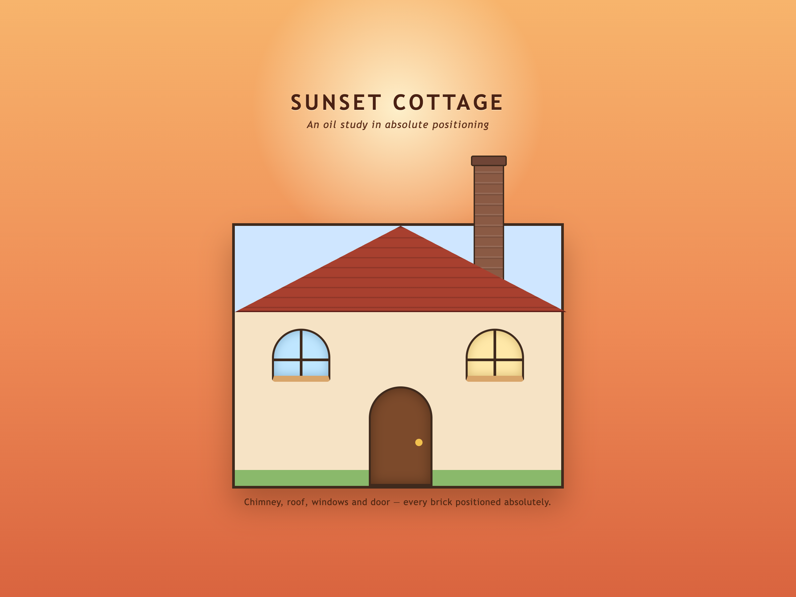
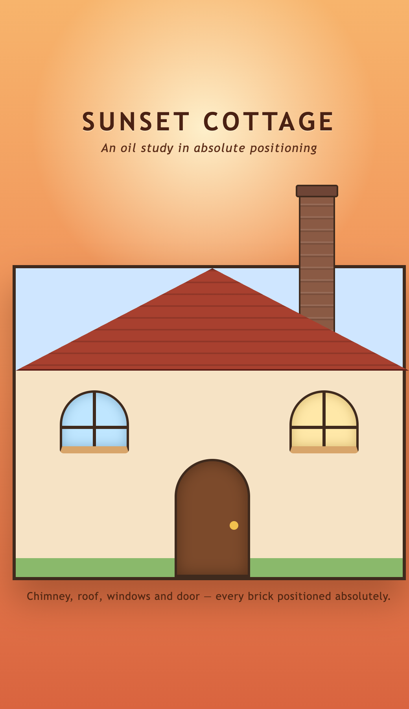

# Sunset Cottage — House Painting

A freeCodeCamp CSS lab: build the structure of a house with HTML, then use CSS
**absolute positioning** to arrange its windows, door, roof and chimney.



## What is being practiced

- An element with `position: relative` acting as the containing block
- Children with `position: absolute` placed with `top` / `bottom` / `left` / `right`
- `z-index` (and how `isolation: isolate` keeps a negative `z-index` inside a stacking context)
- Pseudo-elements (`::before` / `::after`) for extra detail
- Clipping a `div` into a triangle with `clip-path`

## Structure

`index.html` holds a fixed-size "canvas" (`#house`) with exactly five immediate
children. Everything else on the page is decoration:

```
#house
├── #chimney     lifted above the top edge (top mirrors its height), z-index: -1
├── #roof        full width gable, clipped into a triangle, top: 0
├── #window-1    arched window on the left
├── #window-2    arched window on the right
└── #door        centred on the ground floor, bottom: 0
```

## Layout contract

All values are px. `#house` is `500 × 400` with a `4px` border, so its **padding
box** — the box absolutely positioned children are laid out against — is
`492 × 392`.

| Element     | Position                                         | Size      |
| ----------- | ------------------------------------------------ | --------- |
| `#house`    | `position: relative`                             | 500 × 400 |
| `#roof`     | `top: 0`, `left: 0`                               | 500 × 130 |
| `#chimney`  | `top: -100px`, `left: 360px`, `z-index: -1`       | 46 × 100  |
| `#window-1` | `top: 155px`, `left: 56px`                        | 88 × 80   |
| `#window-2` | `top: 155px`, `right: 56px`                       | 88 × 80   |
| `#door`     | `bottom: 0`, `left: 202px`                        | 96 × 150  |

Why these numbers satisfy the user stories:

- the roof starts at `0`, so the windows (`155`) are **below** the roof, and they
  end at `235`, well above the door head (`242`);
- `235 ≤ 392 − 150/3 = 342` keeps both windows higher than a third of the door;
- `left: 360` + `width: 46` = `406 ≤ 492` and `left: 202` + `width: 96` = `298`,
  so the chimney and the door stay inside the house borders;
- the lab pins the chimney to the top of the house with
  `assert.approximately(top, -height, 2)`, so `top` is **exactly `-height`**
  (`-100`). That lifts the whole chimney above the canvas, which is why
  `#chimney::after` repeats the brick shaft downwards: the repeated part is
  painted behind `#roof` and only shows until the gable slope cuts it off;
- `z-index: -1` on `#chimney` pushes it behind the house and roof, which is why
  the cap is drawn with `#chimney::before` at `top: -8px`;
- `#house` carries a `120px` top margin so the overhanging chimney has room
  instead of painting over the title.

The window frame lives in a **grouped** rule, `#window-1, #window-2 { border: … }`,
because the lab looks the `border` up on that combined selector; the per-window
rules only add the sill longhands (`border-bottom-width` / `border-bottom-color`),
which would otherwise collapse the shorthand's serialised value.

`#house` deliberately declares **no** `min-*` or `max-*` properties: the lab asks
for a plain `width` / `height` box.

## Running it

Open `index.html` in a browser — no build step, no dependencies.

## Tests

```bash
npm test        # node contract-test.mjs
```

`contract-test.mjs` re-checks all 47 lab assertions locally: it parses
`styles.css`, resolves the declared `top` / `bottom` / `left` / `right` values
into a box per element and validates the geometry against the padding box of
`#house`. It fails loudly if a rule is dropped — for example removing
`bottom: 0` from `#door` or moving the windows above the roof.

```
49/49 assertions passed (house 500x400, inner 492x392, chimney 46x100)
```

## Screenshots

| Desktop                          | Narrow viewport                         |
| -------------------------------- | --------------------------------------- |
|  |  |

The house keeps its fixed `500px` width, so on narrow screens the body uses
`justify-content: safe center` (with a plain `center` fallback) to align to the
start edge and let the painting be scrolled instead of clipped. `align-items: safe
center` does the same vertically, which matters now that the chimney needs
headroom above the canvas.
